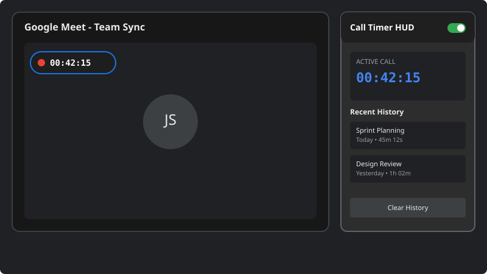

# 🎓 Google Meet Tuition Companion (v2.3.0)

 

An open-source Manifest V3 Chrome Extension that turns Google Meet into a complete tuition companion with auto-starting Material 3 timer, classroom management, dual-audio recording, and database sync.

## 🌟 Major Feature Pillars

### 1. Auto-Starting Material 3 Call Timer & Top-Middle Draggable HUD
- Built with Google Sans typography and Google's Material 3 design system.
- Top-center default placement with full-pill drag-and-drop functionality across the entire viewport.
- Automatic injection on browser restart, 2-hour rejoin persistence, and mid-call start-time recovery.
- Manual time adjustment controls (`-5m`, `-1m`, `+1m`, `+5m`, `+15m`, and exact `HH:MM:SS`).

### 2. 35-Minute Tuition Class Rule & 1 Hour 10 Minute Warning Alert
- Calls reaching 35+ minutes automatically qualify as a Tuition Class (`Class #N`).
- Multi-channel warning alert (red pill, in-call toast banner, 4-tone chime, and desktop notification) fires at 1 hour 10 minutes (70 minutes).

### 3. Custom Class Number Initialization & Monthly Auto-Counting
- Initialize or fix `This Class #` or `Prior Classes (Mo)` for any meeting code if classes were already taken earlier in the month before installing the extension.
- Automatically counts up for the rest of the month and resets to `Class #1` each new calendar month.

### 4. Classrooms Organizer & 1-Click Homework Mail Shortcut
- Organize each Class Link with its Class Name, Students list, Typical Schedule, and Student Mails.
- Includes a 1-click Join button and a 1-click Homework Mail shortcut that opens Gmail Compose pre-addressed to all students.

### 5. Presentation-Focused Self-Recorder (Dual-Audio Video)
- Auto-pins active presentations and records crisp WebM video.
- Mixes both the user's microphone voice and all other participants' WebRTC voices.
- Features a live 4-bar audio level meter directly on the HUD pill.

### 6. Google Calendar & External Database Sync (Survives Extension Removal)
- Auto-logs 35+ minute classes to Google Calendar.
- Syncs two-way with Google Sheets (`Classrooms_Summary` and `Class_Sessions_Log`).
- Saves directly to the local `Documents` folder and mirrors to Chrome account cloud storage to survive extension removal.

## Project File Structure

| File | Description |
| --- | --- |
| `manifest.json` | Manifest V3 metadata, permissions, and script declarations |
| `content.js` | Injected content script for Google Meet DOM timer overlay and dragging logic |
| `popup.html` | Extension toolbar popup markup |
| `popup.js` | History viewing, timer state script, and UI interactions |
| `styles.css` | Styling for HUD overlay, theme, and popup UI |
| `assets/screenshot.svg` | UI preview screenshot graphic |

## Installation Steps

1. **Clone or Download the Repository**:
   Download or clone the project repository to your local computer.
2. **Open Chrome Extensions**:
   Navigate to `chrome://extensions/` in Google Chrome and enable **Developer mode** in the top-right corner.
3. **Load Unpacked Extension**:
   Click **Load unpacked** and select the folder containing the extension source code.
