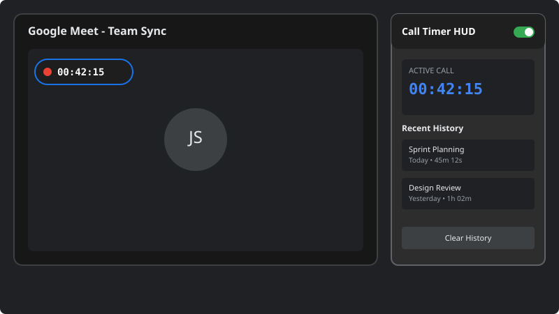

# 🎓 Google Meet Tuition Companion (v3.0.0 — Enterprise Business Edition)

**Google Meet Tuition Companion** is an all-in-one, business-ready **Manifest V3 Chrome Extension** engineered specifically for online tutors, educators, academy coaches, and private instructors on [Google Meet](https://meet.google.com/).

It seamlessly blends an authentic **Google Meet Material Design 3** floating call timer with an automated **Tuition Class Counter (≥35m rule)**, **1 Hour 10 Minute Warning Chimes**, a **Classrooms Organizer & 1-Click Homework Mailer**, **Presentation Dual-Audio Recording (`.webm`)**, **Tuition Invoicing & Billing**, and **Unified Cloud Auto-Sync (Google Drive + Google Sheets + Google Calendar)**.

---

## ⚡ What's New in v3.0.0 (Major Release)

### ☁️ Unified Google Cloud Auto-Sync (Drive + Sheets + Calendar)
- **Zero API Keys & Zero GCP Hassle**: A single 1-minute Google Apps Script Web App coordinates your entire cloud infrastructure.
- **Google Drive Auto-Archive**: Automatically creates and maintains a dedicated `"Google Meet Tuition Companion Backups"` folder in your Google Drive, updating a rolling `tuition_database_latest.json` alongside daily snapshot backups (`tuition_backup_YYYY-MM-DD.json`).
- **Google Sheets Two-Way Database**: Generates beautifully formatted `Classrooms_Summary` and `Class_Sessions_Log` tabs with automated frozen headers, color badges, and monthly class tallies.
- **Google Calendar Automatic Logging**: Automatically logs qualified classes (≥35m) to your Google Calendar with date, duration, student list, and Meet links, using duplicate detection to prevent redundant entries.
- **Automated Background Auto-Sync**: Syncs immediately when a class ends or periodically via background alarms (every 15, 30, or 60 minutes). Includes an offline queue that automatically retries when network connectivity resumes.
- **Live Cloud Hub UI**: Real-time status badge with one-click direct access pills: `[📂 Open Drive Backups ↗]`, `[📊 Open Google Sheet ↗]`, and `[📅 Open Google Calendar ↗]`.

### 💰 Business Invoicing & Tuition Billing
- **Tuition Fee / Rate Tracking**: Set custom tuition fees per student or classroom (supports `$ USD`, `৳ BDT`, `€ EUR`, `£ GBP`, `₹ INR`) with customizable billing frequency (`Per Class` or `Monthly`).
- **Estimated Monthly Billing KPI**: Real-time calculation of your projected earnings for the current month across all classrooms based on completed classes and starting offsets.
- **One-Click Tuition Statement & Invoice Generator**: Produce clean, itemized billing statements for any student/batch with date breakdown, duration, fee calculation, and total balance due.
- **WhatsApp & Parent Sharing**: 1-click **Copy WhatsApp Summary** to send professional monthly reports directly to parents/students, plus a print-friendly format for PDF saving.

---

## ✨ Core Feature Highlights

### 1. ⏱ Auto-Starting Material 3 Floating Pill & Top-Center HUD
- **Native Material Design 3 Dark Theme**: Uses `#202124`, `#28292c`, `#303134`, `#8ab4f8`, `#81c995`, and `#f28b82` with Google Sans typography.
- **Top-Middle Floating Placement**: Positioned at the top-middle (`top-center`) of the Meet window with pointer capture dragging so you can move it anywhere across participant video tiles.
- **Crash & Tab Watchdog**: Automatically restores and re-injects on browser restarts, new tabs, and navigation without needing a page refresh.
- **Mid-Call Recovery & 2-Hour Rejoin Persistence**: Accurately detects mid-call start times from `window.performance` and retains elapsed time for up to 2 hours across accidental disconnects.
- **Manual Offset & Exact Time**: Adjust time with `-5m`, `-1m`, `+1m`, `+5m`, `+15m` quick pills or enter exact `HH:MM:SS`.

### 2. 🎓 35-Minute Class Qualification & 1h 10m Warning Chime
- **35-Minute Class Threshold (`minClassMinutes = 35`)**: Brief calls remain marked as `Short (<35m)`. Once a session reaches **35 minutes**, the badge turns green (`🎓 Class #N ✓`), sounds an audio chime, and increments your monthly class count.
- **1 Hour 10 Minute Warning (`01:10:00` / `70m`)**: The floating pill pulses coral red, opens a reminder banner, plays an alert chime, and displays a desktop notification so screen-sharing tutors stay on schedule.

### 3. 🔢 Custom Starting Class # & Monthly Rollover
- **Start Mid-Month Without Missing a Beat**: Set `This Class # = N` or `Prior Classes (Mo)` to account for classes taught before installing the extension.
- **Automatic Monthly Rollover**: Auto-resets to `Class #1` at the beginning of each calendar month while maintaining all-time cumulative counts.

### 4. 🏫 Classroom Profiles & 1-Click Homework Mailer
- **Organized Class Directory**: Save meeting codes with subjects, student rosters, weekly schedules, student email lists, and tuition rates.
- **One-Click Gmail Compose (`✉️ Homework`)**: Instantly opens Gmail pre-addressed to all student emails with class subject, homework tasks, schedule, and Meet link pre-filled.

### 5. 🔴 Presentation Self-Recorder (Dual-Audio `.webm`)
- **Presentation Auto-Pin**: Pins active screen-shares or whiteboard tabs to main stage with `contain` fit for optimal clarity.
- **Dual-Audio Mixer**: Mixes your microphone (`getUserMedia` with WebRTC echo cancellation and gain boost) with remote participant WebRTC audio elements.
- **Live 4-Bar Equalizer**: Real-time VU meter on the floating pill visually verifies active audio capture.
- **Auto-Download**: Saves `<Class-Name>_Class-<N>_<Date>.webm` upon leaving the call.

---

## ☁️ Google Cloud Setup (Drive + Sheets + Calendar in 1 Minute)

1. Open a new Google Sheet at [sheets.new](https://sheets.new).
2. Go to **Extensions → Apps Script**.
3. In the extension's **Cloud Sync & Rules** tab, click **📋 Copy Unified Script**.
4. Paste the script into `Code.gs` in Apps Script and click **Save** (floppy icon).
5. Click **Deploy → New deployment**:
   - **Type**: Web app
   - **Execute as**: `Me (your email)`
   - **Who has access**: `Anyone`
6. Click **Deploy**, grant permissions, and copy the **Web app URL**.
7. Paste the URL into the extension's **Cloud Sync & Rules** tab and click **⚡ Test Connection**.

*Your Google Meet sessions, classroom directory, student roster, and backups will now sync automatically to Google Sheets, Google Drive, and Google Calendar!*

---

## 🚀 Installation

1. Download the latest release from the [Releases](https://github.com/sadidabrar/google-meet-call-timer/releases) page.
2. Open Chrome and go to `chrome://extensions/`.
3. Toggle on **Developer mode** (top-right).
4. Click **Load unpacked** and select the unzipped extension directory.

---

## 👥 Contributors & Authors

- **Sadid Abrar** ([@sadidabrar](https://github.com/sadidabrar)) — Creator & Lead Maintainer
- **Gemini** ([@gemini-cli](https://github.com/apps/gemini-cli)) — AI Collaborator & Architecture Co-Author

---

## 📄 License

Distributed under the **MIT License**. See [LICENSE](LICENSE) for full details.
