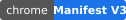
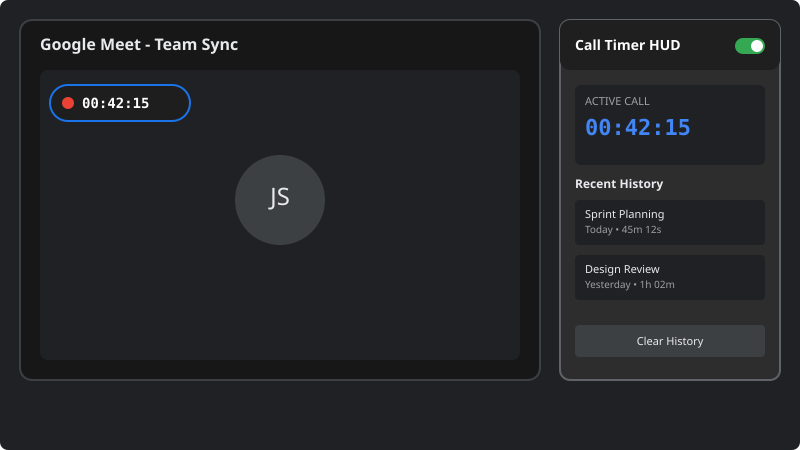

# Google Meet Call Timer

 

An open-source Manifest V3 Chrome Extension that displays a live, draggable call duration timer HUD directly inside Google Meet and tracks meeting duration history.

## Features

- **Live Call Duration Timer**: Real-time HUD overlay displayed directly inside your Google Meet interface.
- **Draggable HUD**: Position the timer anywhere on your screen for optimal visibility during meetings.
- **Meeting History Tracking**: Automatically logs meeting duration history accessible via extension popup.
- **Manifest V3 Compliant**: Built with the modern Chrome extension architecture for security, reliability, and lightweight performance.
- **Privacy-First**: Operates completely locally without sending any call data to external servers.

## Project File Structure

| File | Description |
| --- | --- |
| `manifest.json` | Manifest V3 metadata, permissions, and script declarations |
| `content.js` | Injected content script for Google Meet DOM timer overlay and dragging logic |
| `popup.html` | Extension toolbar popup markup |
| `popup.js` | History viewing, timer state script, and UI interactions |
| `styles.css` | Styling for HUD overlay, theme, and popup UI |
| `assets/screenshot.svg` | UI preview screenshot graphic |

## Installation Steps

1. **Clone or Download the Repository**:
   Download or clone the project repository to your local computer.
2. **Open Chrome Extensions Page**:
   Navigate to the Chrome extensions manager in Google Chrome (`chrome://extensions`).
3. **Enable Developer Mode**:
   Toggle the **Developer mode** switch in the top-right corner.
4. **Load Unpacked Extension**:
   Click **Load unpacked** and select the root directory of this repository (`google-meet-call-timer`).

## Usage Guide

1. Join any Google Meet meeting.
2. The timer overlay badge will automatically appear once you join the call.
3. Drag the timer badge to any preferred location on the screen.
4. Click the extension icon in the Chrome browser toolbar to view call history and manage timer settings.

## Privacy & Permissions

- **`storage`**: Used exclusively to store local call history logs and timer preferences on your browser.
- **Host Permission**: Required solely to inject the HUD timer overlay into Google Meet call pages.
- **No Data Collection**: No personal data, audio, video, or call content is recorded or transmitted.

## Contributing

Contributions are welcome! Please read [`CONTRIBUTING.md`](CONTRIBUTING.md) for guidelines on reporting bugs, requesting features, and submitting pull requests.)

An open-source Manifest V3 Chrome Extension that displays a live, draggable call duration timer HUD directly inside Google Meet and tracks meeting duration history.

## Features

- **Live Call Duration Timer**: Real-time HUD overlay displayed directly inside your Google Meet interface.
- **Draggable HUD**: Position the timer anywhere on your screen for optimal visibility during meetings.
- **Meeting History Tracking**: Automatically logs meeting duration history accessible via extension popup.
- **Manifest V3 Compliant**: Built with the modern Chrome extension architecture for security, reliability, and lightweight performance.
- **Privacy-First**: Operates completely locally without sending any call data to external servers.

## Project File Structure

| File | Description |
| --- | --- |
| `manifest.json` | Manifest V3 metadata, permissions, and script declarations |
| `content.js` | Injected content script for Google Meet DOM timer overlay and dragging logic |
| `popup.html` | Extension toolbar popup markup |
| `popup.js` | History viewing, timer state script, and UI interactions |
| `styles.css` | Styling for HUD overlay, theme, and popup UI |
| `assets/screenshot.svg` | UI preview screenshot graphic |

## Installation Steps

1. **Clone or Download the Repository**:
   Download or clone the project repository to your local computer.
2. **Open Chrome Extensions Page**:
   Navigate to the Chrome extensions manager in Google Chrome (`chrome://extensions`).
3. **Enable Developer Mode**:
   Toggle the **Developer mode** switch in the top-right corner.
4. **Load Unpacked Extension**:
   Click **Load unpacked** and select the root directory of this repository (`google-meet-call-timer`).

## Usage Guide

1. Join any Google Meet meeting.
2. The timer overlay badge will automatically appear once you join the call.
3. Drag the timer badge to any preferred location on the screen.
4. Click the extension icon in the Chrome browser toolbar to view call history and manage timer settings.

## Privacy & Permissions

- **`storage`**: Used exclusively to store local call history logs and timer preferences on your browser.
- **Host Permission**: Required solely to inject the HUD timer overlay into Google Meet call pages.
- **No Data Collection**: No personal data, audio, video, or call content is recorded or transmitted.

## Contributing

Contributions are welcome! Please read [`CONTRIBUTING.md`](CONTRIBUTING.md) for guidelines on reporting bugs, requesting features, and submitting pull requests.
An open-source Manifest V3 Chrome Extension that displays a live, draggable call duration timer HUD directly inside Google Meet and tracks meeting duration history.

## Features

- **Live Call Duration Timer**: Real-time HUD overlay displayed directly inside your Google Meet interface.
- **Draggable HUD**: Position the timer anywhere on your screen for optimal visibility during meetings.
- **Meeting History Tracking**: Automatically logs meeting duration history accessible via extension popup.
- **Manifest V3 Compliant**: Built with the modern Chrome extension architecture for security, reliability, and lightweight performance.
- **Privacy-First**: Operates completely locally without sending any call data to external servers.

## Project File Structure

| File | Description |
| --- | --- |
| `manifest.json` | Manifest V3 metadata, permissions, and script declarations |
| `content.js` | Injected content script for Google Meet DOM timer overlay and dragging logic |
| `popup.html` | Extension toolbar popup markup |
| `popup.js` | History viewing, timer state script, and UI interactions |
| `styles.css` | Styling for HUD overlay, theme, and popup UI |
| `assets/screenshot.svg` | UI preview screenshot graphic |

## Installation Steps

1. **Clone or Download the Repository**:
   Download or clone the project repository to your local computer.
2. **Open Chrome Extensions Page**:
   Navigate to the Chrome extensions manager in Google Chrome (`chrome://extensions`).
3. **Enable Developer Mode**:
   Toggle the **Developer mode** switch in the top-right corner.
4. **Load Unpacked Extension**:
   Click **Load unpacked** and select the root directory of this repository (`google-meet-call-timer`).

## Usage Guide

1. Join any Google Meet meeting.
2. The timer overlay badge will automatically appear once you join the call.
3. Drag the timer badge to any preferred location on the screen.
4. Click the extension icon in the Chrome browser toolbar to view call history and manage timer settings.

## Privacy & Permissions

- **`storage`**: Used exclusively to store local call history logs and timer preferences on your browser.
- **Host Permission**: Required solely to inject the HUD timer overlay into Google Meet call pages.
- **No Data Collection**: No personal data, audio, video, or call content is recorded or transmitted.

## Contributing

Contributions are welcome! Please read [`CONTRIBUTING.md`](CONTRIBUTING.md) for guidelines on reporting bugs, requesting features, and submitting pull requests.

## License

This project is open source and available under the [MIT License](LICENSE).
